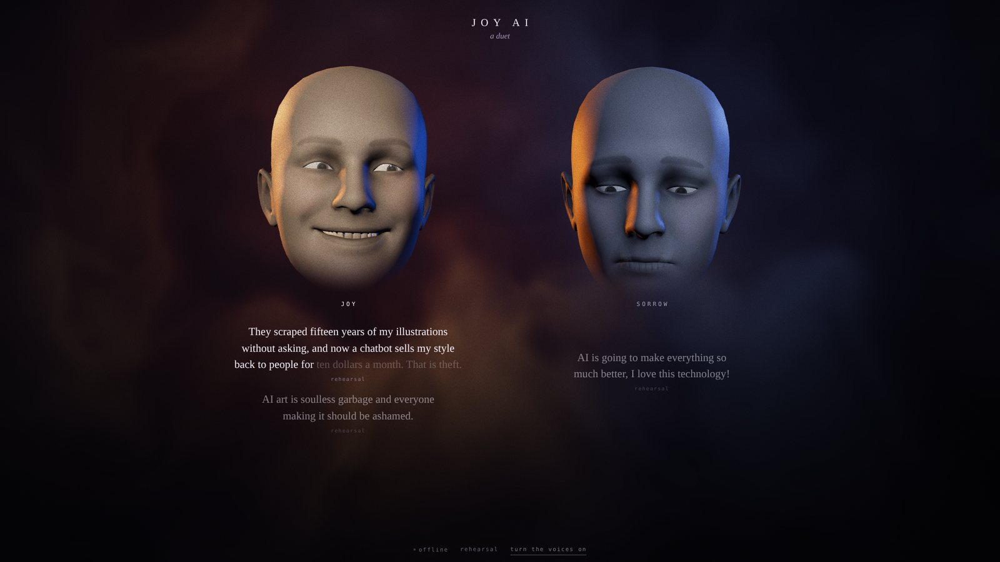

# Joy AI

*A duet.*



Internet opinions about generative AI, read aloud **verbatim** by two
faces — each in the wrong voice.

- **Anti-AI / negative comments** are read by **Joy**: beaming, bright,
  quick.
- **Pro-AI / positive comments** are read by **Sorrow**: grieving, low,
  slow.

The words are never changed. Only the delivery is wrong. Comments that
aren't in English are translated faithfully so the voices can read
them; neutral text, which has no feeling to contradict, is left out.

And the delivery doesn't quite hold. While a face performs, the feeling
the words actually carry breaks through as a **micro-expression** — a
flash of contempt, disgust, anger or fear across Joy's smile, of real
delight across Sorrow's grief — and is gone again in under half a
second.

## What you see

**The faces** are a photogrammetry scan of a real head (`facecap.glb`,
from the three.js examples), driven through its 52 ARKit blendshapes.
Each face is composed every frame from independent layers:

| Layer | What it does |
|---|---|
| Mask | The performed affect — a Duchenne smile, or grief — put on a beat before the first word and let go slowly after the last. Stronger sentiment, harder performance. |
| Slip | Micro-expressions. Ekman's universal emotions mapped from FACS action units to the rig, with a fast onset, a brief apex and a slower release (250–500 ms in all). Triggered by emotionally loaded words as they are spoken, and spontaneously in proportion to the sentiment being read against. A face can only leak what it is hiding. Afterwards the mask over-corrects, and the eyes tend to flinch. |
| Mouth | Visemes derived from spelling, timed to the browser voice's word-boundary events where it reports them and to a learned estimate where it doesn't. |
| Eyes | Saccades between the viewer, the other face, and elsewhere, with real eyeball rotation, lids that follow the gaze, fixational tremor, and blinks (Sorrow's are slower). The listener watches the speaker. |
| Head | Posture, drift, a nod on each weighty word, a recoil on a slip. |

Nothing on screen names a slip. The only trace is the word that caused
it, briefly marked in the other face's colour.

**The background** is a field of smoke the two faces share: warm and
rising behind Joy, cold and sinking behind Sorrow. Each side swells
while its face has the floor and breathes with the voice. On a slip the
face's own light gutters and a ring of the *other* temperature escapes
outward. The heads are lit by their own smoke from behind and by each
other's across the gap.

**The text** appears under each face as it is read, word by word.

**The voice** is one voice in two deliveries, because the two faces are
one face. A small service wraps [Piper](https://github.com/OHF-Voice/piper1-gpl),
a neural text-to-speech engine that runs on a CPU, and records each
comment before it is broadcast: raised about two semitones, quick and
lively for Joy; lowered about two and a half, slow and flat, with long
silences between sentences, for Sorrow. Each recording comes with the
exact time of every word, so the captions and the lips follow the
sound itself, and the mouth opens with its real loudness. Joy sits a
little to the left of the stereo image, Sorrow a little to the right.

Where there is no recording (no voice service, rehearsal without
pre-recorded clips) the browser's own Web Speech voices read instead,
and with sound off the faces read silently.

## Running it

With no keys at all, to see the piece on rehearsal material:

```sh
cabal run joyai
```

Open <http://localhost:8080/> and press **rehearsal** (or load
`/?rehearsal`). Browsers only allow speech after a gesture, so the
piece opens silent and reads silently until you **turn the voices on**.

With a live feed:

```sh
export TAVILY_API_KEY=tvly-...
export LLM_API_KEY=...          # key for your chat-completions provider
cabal run joyai
```

With the recorded voice as well (the Docker image does all of this for
you):

```sh
pip install "piper-tts[alignment]"
python -m piper.download_voices --download-dir voices en_US-joe-medium
PIPER_VOICE=voices/en_US-joe-medium.onnx python tts/server.py &
export TTS_URL=http://127.0.0.1:5005/speak
cabal run joyai
```

The frontend is plain static files with no build step, so it can also
be served by anything (`python3 -m http.server -d frontend`) and run on
rehearsal alone, or pointed at a backend elsewhere with
`?ws=wss://host/ws`. To give the rehearsal lines the recorded voice
too, run `node tools/render-rehearsal.mjs` while the voice service is
up; it writes the clips into `frontend/assets/voice`.

### Controls

| | |
|---|---|
| `M`, or the sound control | voices on / off |
| `R`, or **rehearsal** | queue the rehearsal material |
| `S` | slow the slips to a seventh of their speed, to study them |
| `?rehearsal` | start in rehearsal (for kiosks and static hosting) |
| `?slips=slow` | start with slowed slips |
| `?ws=<url>` | take the live feed from another host |

When nothing new arrives for a while, the faces go back over things
already said, so an unattended installation never falls silent for
long.

### Configuration

| Variable | Default | Notes |
|---|---|---|
| `TAVILY_API_KEY` | — | Without this and `LLM_API_KEY` the server runs in rehearsal-only mode |
| `LLM_API_KEY` | — | API key for the LLM provider (`ANTHROPIC_API_KEY` also works for Claude) |
| `LLM_PROVIDER` | — | `anthropic` to use Claude through its own Messages API; otherwise any OpenAI-compatible provider |
| `LLM_BASE_URL` | `https://api.z.ai/api/paas/v4/chat/completions` | Full endpoint URL (Claude: `https://api.anthropic.com/v1/messages`) |
| `LLM_MODEL` | `glm-4.5-air` | Claude default: `claude-opus-5-5` |
| `PORT` | `8080` | The one port everything is served on |
| `POLL_SECONDS` | `60` | Pause between search cycles |
| `FRONTEND_DIR` | `frontend` | Where the static files live |
| `TAVILY_BASE_URL` | `https://api.tavily.com/search` | Override for testing against a stub |
| `TTS_URL` | — | The voice service's `/speak` endpoint. Unset: browser voices. The Docker image sets it itself |
| `PIPER_VOICE` | — | For `tts/server.py`: path to the voice's `.onnx` file |

Any OpenAI-compatible provider works. Kimi (Moonshot), for example:

```sh
export LLM_BASE_URL=https://api.moonshot.ai/v1/chat/completions
export LLM_MODEL=kimi-k2-0905-preview
```

Claude is spoken to natively, with a JSON schema guaranteeing the shape
of the reply:

```sh
export LLM_PROVIDER=anthropic
export LLM_API_KEY=sk-ant-...
export LLM_MODEL=claude-haiku-5-5   # optional; much cheaper than the default
```

## How it works

```
[ Tavily Search API ]
        │  search results, queries asked in rotation
        ▼
┌──────────────────────────────────────────────────────┐
│ Haskell backend                                      │
│  1. Ingest, clean (tags, entities, URLs), excerpt    │
│     to whole sentences a voice can read              │
│  2. Skip anything already seen                       │
│  3. LLM annotation: sentiment (+ English if needed)  │
│  4. Pure routing: the face that contradicts it       │
│  5. Broadcast; keep the last 24 for latecomers       │
└──────────────────────────────────────────────────────┘
        │  WebSocket frames (/ws, same port as the page)
        ▼
[ Frontend: two faces, two voices, one field ]
```

| Path | Role |
|---|---|
| `src/Types.hs` | Algebraic data types (`SentimentScore`, `AvatarTarget`, `CommentPayload`) — the wire format |
| `src/Logic.hs` | Pure core, no IO imports: juxtaposition routing, excerpting, attribution |
| `src/Network/Tavily.hs` | Search ingestion and text cleaning, errors in `ExceptT` |
| `src/Network/LLM.hs` | Annotation engine (OpenAI-compatible chat completions, or the Claude Messages API) |
| `src/Network/Voice.hs` | Client for the voice service |
| `app/Main.hs` | Warp server: static frontend, `/health`, `/voice`, WebSocket feed, polling loop |
| `tts/server.py` | The voice service: Piper, the two deliveries, word timings |
| `tools/render-rehearsal.mjs` | Pre-records the rehearsal lines |
| `docker/entrypoint.sh` | Starts the voice service, then the backend |
| `test/Spec.hs` | Checks for the pure core and the wire format |
| `frontend/js/main.js` | Dramaturgy: queues, turn-taking, captions, live feed |
| `frontend/js/performer.js` | One face: the layered facial performance |
| `frontend/js/affect.js` | Masks, micro-expressions, loaded words, visemes — all the data |
| `frontend/js/speech.js` | Text → timed script; plays recordings, or drives Web Speech with boundary sync |
| `frontend/js/stage.js` | The single WebGL canvas: heads, lights, layout |
| `frontend/js/field.js` | The smoke field and film grain shaders |
| `frontend/js/rehearsal.js` | Invented comments for running without a feed |

```sh
cabal build
cabal test
```

The stage watches its own frame time and gives up resolution before
smoothness: on a machine that cannot keep up, the canvas is rendered
smaller and scaled.

All three.js modules, decoders and the face model are vendored in
`frontend/vendor` and `frontend/assets` — no CDN, works offline.

## Deploying

```sh
docker build -t joyai .
docker run -p 8080:8080 \
  -e TAVILY_API_KEY=... -e LLM_API_KEY=... joyai
```

Everything is on one port, and the page finds its feed at `/ws` on its
own origin, so it works unchanged behind any TLS-terminating proxy or
on single-port hosts (Render, Fly.io, Railway). `PORT` is honoured.

The image carries the voice service and a voice, downloaded from
Hugging Face while building. Choose another with
`--build-arg PIPER_VOICE=en_US-norman-medium`, or leave the voice out
with `--build-arg PIPER_VOICE=` and the piece falls back to browser
voices. Synthesis is CPU-only and wants roughly half a gigabyte of
memory.

## Safety constraints

- No `head`, `read`, `fromJust`, or `undefined` — partial failure paths
  use `Maybe` / `Either`.
- Network errors and rate limits are carried in `ExceptT`, and the
  polling loop catches everything else, so a failed cycle never takes
  the server down.
- The LLM only labels and translates. Routing is decided by pure code,
  the comment text is passed through untouched, and it is always
  inserted into the page as text, never as markup.

## Credits & License

- Face model: `facecap.glb` from the
  [three.js examples](https://github.com/mrdoob/three.js), captured with
  [Face Cap](https://bannaflak.com/face-cap/); three.js is MIT-licensed.
- Micro-expression shapes follow Ekman & Friesen's Facial Action Coding
  System.
- Voice: [Piper](https://github.com/OHF-Voice/piper1-gpl) is GPL-3.0 and
  runs as its own service; `tts/server.py` imports it and is therefore
  under the GPL's terms when distributed with it. Voices carry their
  own licences: the default, `en_US-joe-medium`, is CC0, and several
  popular ones (`ryan`, `hfc_male`) are non-commercial only.
- Everything else: [WTFPL](LICENSE) — Do What The Fuck You Want To
  Public License, version 2.
